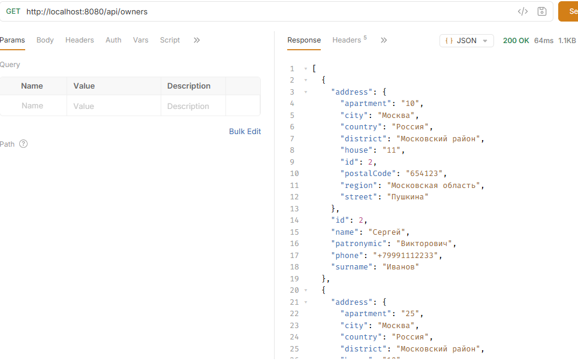
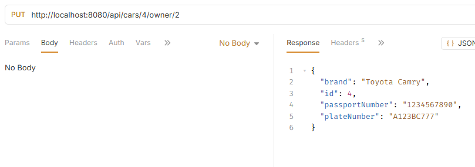
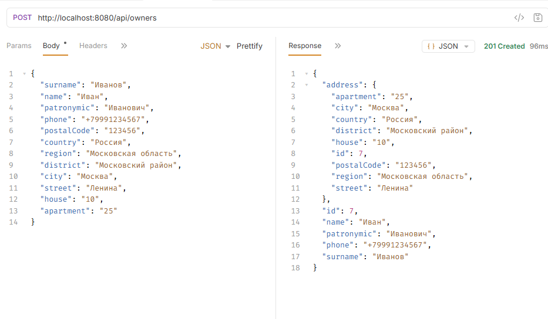
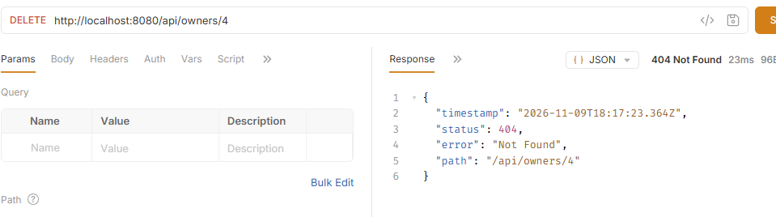

## Цель работы
Создание Spring-приложение с несколькими таблицами с использованием REST API

## Архитектура проекта
- **Стек:** Spring Boot 3, Spring Data JPA, Maven.
- **СУБД:** H2, PostgreSQL
- **Основные слои:** 
  - Controller (endpoints)
  - Repository (методы для получения данных)
  - Controller — обработка HTTP-запросов
  - Entity — описание сущностей и связей между таблицами.
  - DTO — передача и валидация входных данных.
- **Ключевые аннотации:**
- @Entity
- @Table
- @Id
- @GeneratedValue
- @OneToOne
- @OneToMany
- @ManyToOne
- @JoinColumn 
- @RestController
- @RequestMapping
- @GetMapping
- @PostMapping, @PutMapping
- @DeleteMapping
- @RequestBody
- @PathVariable
- @RequestParam 
- @Valid
- @NotBlank
- @NotNull
- @Size
- @Pattern
- @Transactional
- @Query
- @Param 
- **Описание моделей данных и DTO**
- Owner — владелец автомобиля (ФИО, телефон, адрес).
- Car — автомобиль (марка, государственный номер, номер техпаспорта).
- Address — адрес владельца.
- OwnerCreateDTO — данные для создания и изменения владельца.
- CarCreateDTO — данные для создания и изменения автомобиля.
- SearchDTO — параметры поиска автомобилей.

## Алгоритм работы
 - Spring Boot запускает приложение и подключается к базе данных.
 - REST-контроллер принимает HTTP-запросы и обрабатывает переданные данные.
 - DTO проверяют корректность входных данных с помощью Bean Validation.
 - Repository выполняет операции с базой данных через Spring Data JPA.
 - Реализованы операции CRUD для владельцев и автомобилей:
     - получение всех записей и поиск по ID;
     - добавление новых записей;
     - изменение существующих записей;
     - удаление записей.
 - Дополнительно реализованы:
     - поиск автомобилей по марке, номеру, фамилии владельца и городу;
     - передача автомобиля другому владельцу;
     - получение статистики по владельцам, автомобилям и маркам.
## Скриншоты результатов тестирования (curl или Postman)

 ### Get Список владельцев
  
  
  ### Put Передача автомобиля другому владельцу
  
  
  ### Post Добавление владельца
  
  
  ### Delete Удаление владельца автомобиля
  
