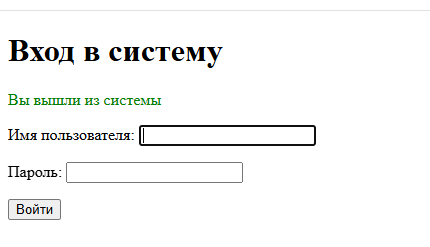
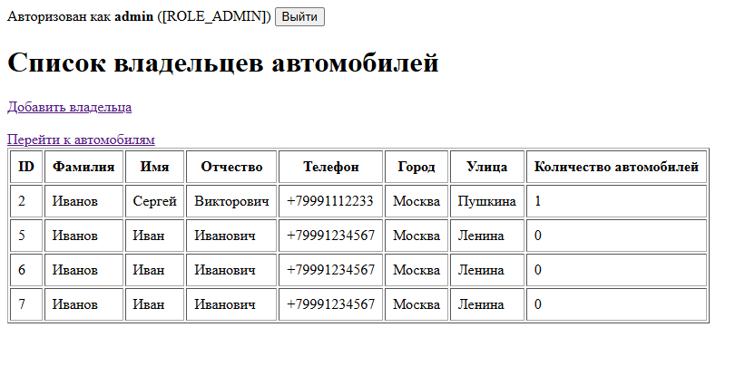
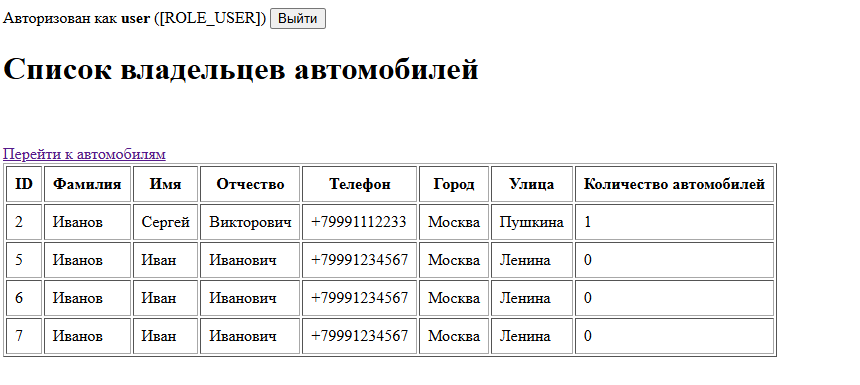
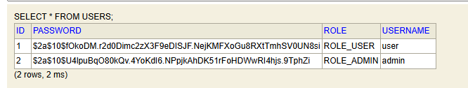

## Цель работы
Научиться использовать фреймворк Spring Security для аутентификации пользователей

## Архитектура проекта
- **Стек:** Spring Boot 3, Spring Security, Spring Data JPA, Thymeleaf, Maven
- **СУБД:** H2
- **Основные слои:** 
  - Controller (endpoints)
  - Repository (методы для получения данных)
  - Service (реализация UserDetailsService для загрузки пользователя при аутентификации)
  - Entity (JPA-сущности)
  - DTO (объекты передачи данных для форм и поиска)
  - Security (конфигурация безопасности, роли, генерация хешей паролей)
  - View (Thymeleaf-шаблоны)
- **Ключевые аннотации:**
  - @Controller
  - @GetMapping
  - @PostMapping
  - @ModelAttribute
  - @Valid
  - @Configuration
  - @EnableWebSecurity
  - @Bean
  - @Service
  - @Autowired
  - @Entity
  - @Table
  - @Id
  - @GeneratedValue
  - @Column
  - @Enumerated
  - @Override
- **Описание моделей данных и DTO**
  - Owner — владелец автомобиля (ФИО, телефон, адрес).
  - Car — автомобиль (марка, государственный номер, номер техпаспорта).
  - Address — адрес владельца.
  - OwnerCreateDTO — данные для создания и изменения владельца.
  - CarCreateDTO — данные для создания и изменения автомобиля.
  - SearchDTO — параметры поиска автомобилей.
  - User — пользователь системы
- **Описание реализованных мапперов**
  - Отдельные классы-мапперы не выделены; преобразование DTO → Entity выполняется вручную в методах контроллера:
    - saveOwner(...) — OwnerCreateDTO → Address + Owner
    - saveCar(...) — CarCreateDTO → Car с привязкой к Owner через owner.addCar(car)
## Алгоритм работы
- Добавление зависимости spring-boot-starter-security — после запуска все страницы защищены, неавторизованных перенаправляет на /login.
- Класс SecurityConfig (@Configuration, @EnableWebSecurity) задаёт цепочку фильтров:
  - только для ADMIN: /owners/new, /cars/new, /owners/delete/**, /cars/update/** и т.п.;
  - всё остальное — только после входа;
  - настройки formLogin (своя страница /login, успех → /owners) и logout.
- Пароли шифруются BCryptPasswordEncoder (бин PasswordEncoder); хеши для заполнения БД генерирует утилита PasswordGen.
- Пользователь в БД: сущность User (@Entity) реализует UserDetails, роль хранится в enum Role implements GrantedAuthority (ROLE_USER, ROLE_ADMIN).
- Загрузка пользователя: UserService implements UserDetailsService через UserRepository.findByUsername(...) достаёт User из БД и отдаёт Spring Security; если не найден — UsernameNotFoundException.
- Своя страница входа login.html — POST-форма на /login с полями username/password, вывод сообщений ?error и ?logout.
- Проверка: под user доступен только просмотр, под admin — ещё и создание/удаление/редактирование; без входа — редирект на /login, при недостатке прав — 403.

## Скриншоты результатов тестирования

 ### Страница входа
  
  
  ### Вход пользователя с ролью admin
  
  
  ### Вход пользователя с ролью user
  
  
  ### Пользователи в бд
  
